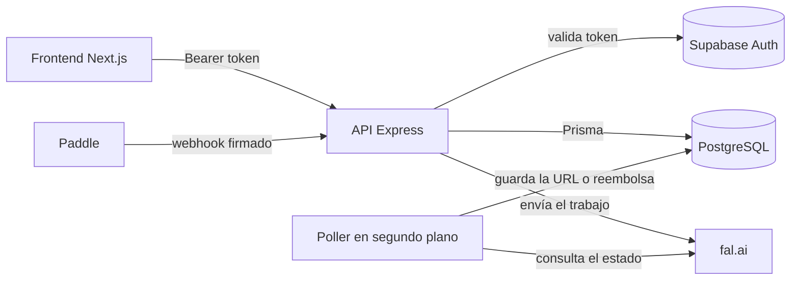

# Stone Studio · Backend

API REST de **Stone Studio**, una plataforma SaaS para generar videos con inteligencia artificial a partir de un texto.

- 🌐 Producto online: [stonestudio.cc](https://www.stonestudio.cc)
- 🖥️ Frontend: [mi-generador-de-videos-frontend-v4](https://github.com/damy19/mi-generador-de-videos-frontend-v4)

## Qué resuelve

El usuario escribe un prompt, elige calidad, formato y duración, y recibe un video generado por IA. El backend se encarga de autenticarlo, cobrarle en tokens, enviar el trabajo al proveedor de IA, seguirlo hasta que termina y entregarle el video.

## Funcionalidades principales

- **Autenticación con Supabase.** Un middleware valida el access token de Supabase (login con Google) en cada ruta protegida. En el primer ingreso, el usuario se crea automáticamente en la base.
- **Generación de video con 4 niveles de calidad** a través de fal.ai: Kandinsky 5 Distill, Kandinsky 5 Pro, MiniMax Hailuo 2.3 Pro y Kling 2.6 Pro, cada uno con su costo en tokens.
- **Cobro seguro en tokens.** El video se crea y los tokens se descuentan dentro de una misma transacción de Prisma. Cada usuario puede tener una sola generación activa a la vez.
- **Procesamiento asíncrono.** Un poller en segundo plano consulta el estado de los trabajos pendientes, con intervalo, tiempo máximo y tope de errores configurables. Si el servidor se reinicia, retoma los videos que habían quedado en curso.
- **Reembolso automático.** Si el proveedor falla o no devuelve un ID de trabajo, los tokens vuelven al usuario.
- **Proxy de streaming con HTTP Range.** Los videos se sirven a través del backend, sin exponer la URL del proveedor, y se pueden adelantar o retroceder en el reproductor.
- **Pagos con Paddle.** El webhook verifica la firma `Paddle-Signature` sobre el body crudo y acredita los tokens de forma idempotente: una misma compra nunca se acredita dos veces. Planes: Starter, Creator, Pro y Business.

## Stack

| Área | Tecnologías |
|---|---|
| Servidor | Node.js, Express 5 |
| Base de datos | PostgreSQL (Supabase) + Prisma ORM, con migraciones |
| Autenticación | Supabase Auth (JWT), Google OAuth |
| IA | fal.ai (`@fal-ai/client`); API de Kling con autenticación JWT (image-to-video, experimental) |
| Pagos | Paddle (`@paddle/paddle-node-sdk`) |
| Deploy | Render |

## Arquitectura



### Flujo de una generación

1. El frontend llama a `POST /api/videos/crear` con el token del usuario.
2. `verifyToken` valida el token contra Supabase.
3. Se validan el prompt, el modelo y el formato, y se verifica que el usuario tenga tokens suficientes y ninguna generación en curso.
4. En una transacción se crea el video en estado pendiente y se descuentan los tokens.
5. Se envía el trabajo a fal.ai y se guarda el `request_id`.
6. El poller sigue el trabajo: si termina, guarda la URL del video; si falla, lo marca con error y reembolsa los tokens.
7. El frontend consulta `GET /api/videos/:videoId/status` y reproduce el video desde `GET /api/videos/stream/:videoId`.

## Estructura

```
src/
├── index.js                  # App Express, middlewares, rutas y arranque del poller
├── config/
│   ├── prisma.js             # Cliente de Prisma
│   └── paddlePlans.js        # Planes de Paddle → cantidad de tokens
├── controllers/
│   ├── videoController.js    # Generación, polling, reembolsos y streaming
│   ├── webhookController.js  # Webhook de Paddle (firma + idempotencia)
│   ├── authController.js     # Usuario autenticado
│   └── transactionController.js
├── middleware/
│   └── authMiddleware.js     # Validación del token de Supabase
├── routes/                   # Definición de endpoints
└── utils/
    └── supabaseAdmin.js      # Cliente admin de Supabase
prisma/
├── schema.prisma             # Modelos User, Video, Transaction y Checkout
└── migrations/
utils/                        # Helpers de la API de Kling
```

## Endpoints

| Método | Ruta | Auth | Descripción |
|---|---|---|---|
| GET | `/api/status` | — | Estado del servidor |
| GET | `/api/auth/me` | Bearer | Datos del usuario (lo crea si es su primer ingreso) |
| POST | `/api/videos/crear` | Bearer | Crea una generación (`prompt`, `duracion`, `aspect_ratio`, `model_type`) |
| GET | `/api/videos/mis-videos` | Bearer | Lista los videos del usuario |
| GET | `/api/videos/:videoId` | Bearer | Detalle de un video |
| GET | `/api/videos/:videoId/status` | Bearer | Estado de la generación |
| GET | `/api/videos/stream/:videoId` | — | Streaming del video (HTTP Range) |
| GET | `/api/transactions/mis-transacciones` | Bearer | Últimos movimientos de tokens |
| POST | `/api/webhook` | Firma de Paddle | Acredita tokens y actualiza el plan |

## Cómo correrlo localmente

Necesitás Node.js 20 o superior, un proyecto de Supabase (Postgres + Auth) y cuentas en fal.ai y Paddle (en modo sandbox para pruebas).

```bash
git clone https://github.com/damy19/mi-generador-de-videos-backend-v4.git
cd mi-generador-de-videos-backend-v4
npm install
cp .env.example .env        # completá las variables con tus claves
npx prisma migrate deploy   # crea las tablas
npm run dev                 # http://localhost:3000
```

Las variables necesarias están explicadas en [`.env.example`](.env.example).

## Autor

**Damian Muni** · Desarrollador Full Stack · [LinkedIn](https://www.linkedin.com/in/damian-muni-aa0600179/)
